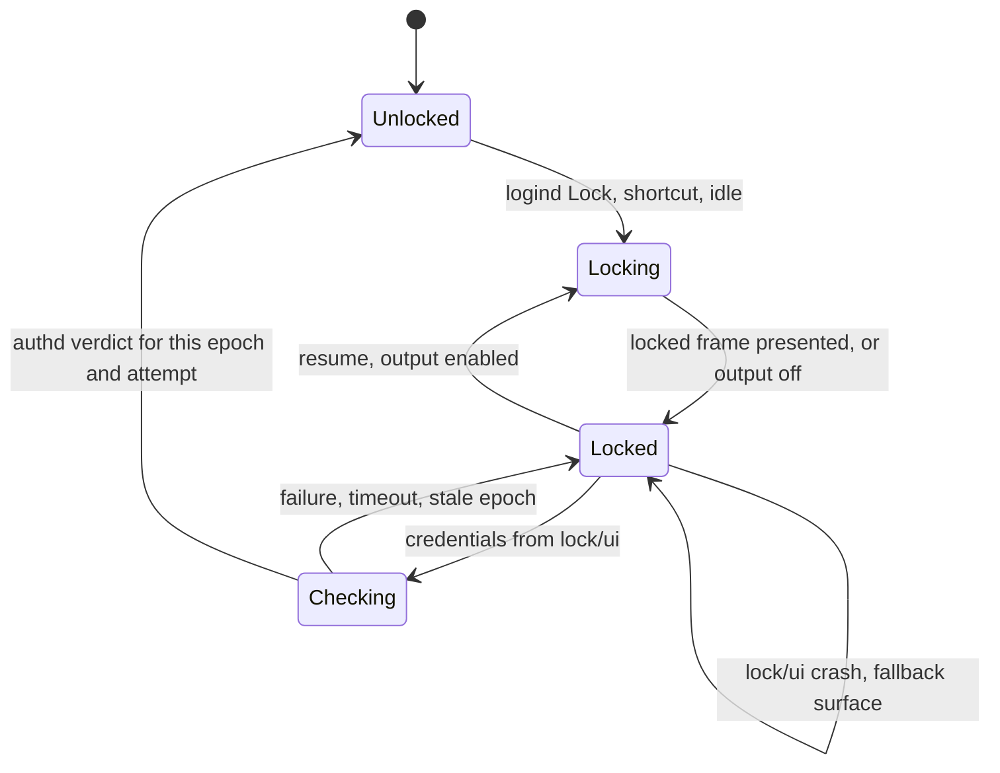

# Design

Skorupa is a Wayland desktop for one laptop screen, split into processes with different rights.
This document says how the parts fit together and why. Requirements with ids are in
[requirements.md](requirements.md), the threat model in [threat-model.md](threat-model.md).

## Goals

- **Secure by default.** A client gets nothing it was not granted. Only the lock sees passwords.
  Prompts cannot be imitated, covered or captured.
- **Balanced.** Ask only where the answer changes something. Show what is live, make it easy to stop.
- **Fast.** Latency and frame pacing at 120 and 180 Hz no worse than niri on the same laptop.
- **Small.** At most 100k lines of Rust including tests; see [Budget](#budget).
- **Standard.** Applications need nothing Skorupa-specific.

Out of scope: NVIDIA, several GPUs, several screens at once, X11 and XWayland, floating windows
(dialogs and popups excepted), a settings GUI.

## Processes

| Process | Rights | Owns | Never |
| --- | --- | --- | --- |
| `compositor` | DRM master and input devices through logind | windows, grants, lock state, reserved strip, trusted input routing | passwords at rest, text rendering of prompts, `exec` |
| `lock/ui` | trusted-renderer role, no lock object | draws password and consent prompts, one fresh process per prompt | deciding anything |
| `lock/authd` | user | the one-use unlock verdict for an epoch and attempt | GUI, network, D-Bus |
| `lock/pwcheck` | root without capabilities, socket-activated | one `pam_authenticate` plus `pam_acct_mgmt` | state between calls |
| `lock/bridge` | user | logind and polkit on D-Bus | unlock authority |
| `shell` | panel role | panel, launcher, notifications, built-in widgets | passwords, screen pixels |
| `shell` plugin view | plugin role | one interpreted `.slint` view with its provider's data | notifications, window list |
| `portal` | capture after a choice made in the compositor | xdg-desktop-portal backends | its own consent UI |
| `sandbox` launcher | user, then namespaces | agent profiles, network gate, cgroups | GUI |
| agent desk | inside the sandbox | a headless compositor per agent | the host session |

`protocol/` holds the binary frames between these processes: length-prefixed, versioned, bounded,
fuzzed.

## Trust model

**Connections.** The default socket gives the `app` domain and the baseline globals. The shell,
portal and lock receive their connections as inherited descriptors from the compositor or systemd,
never by process name. Sandboxed apps and agents connect through `security-context-v1` sockets
created by their launcher. No UID, PID, app id or D-Bus name is an identity.

| Capability | app | sandboxed | agent | shell | portal | lock/ui |
| --- | --- | --- | --- | --- | --- | --- |
| xdg-shell, input, clipboard by focus | yes | yes | own desk | yes | no | yes |
| layer-shell | no | no | no | yes | no | no |
| window list, workspaces | no | no | no | yes | no | no |
| screen capture | via portal | via portal | own desk | no | after choice | no |
| virtual keyboard and pointer | no | no | own desk | no | later | no |
| data-control | no | no | no | no | no | no |

**Enforcement.** Grants are checked when an object is created, on every sensitive request, and
on revocation. Revocation ends streams, input queues and transfers at the last point Skorupa
controls. Lock, resume and restart end live grants.

**Two kinds of unsandboxed client.** An ordinary application that uses only desktop interfaces
(Wayland, portals, the session bus) gets the guarantees in this document. Unrestricted code
running as the user can also read the user's files, attach to the user's processes and talk to
PipeWire directly; Skorupa gives no lock, confidentiality or prompt-authenticity guarantee
against it, and the [threat model](threat-model.md) lists what still holds. Deployment requires
that the user is not in the `input` group and that ptrace is restricted.

## Lock and authentication

- **Only `authd` unlocks.** The compositor unlocks on a one-use verdict bound to compositor
  instance, session, lock epoch and attempt. In `ext-session-lock` the lock client unlocks
  itself, so `lock/ui` gets a render-only role instead; the standard protocol is used only for the
  first bring-up with an unchanged locker.
- **Acknowledge after presentation.** Lock is confirmed only after a locked frame is on screen.
  Sleep waits for that confirmation. A resume or a returning output voids the confirmation, and
  credentials are taken only while a current locked frame is on screen.
- **A sleep acknowledgement is a commitment.** From the acknowledgement until the sleep is over
  the compositor accepts no verdict (the sleep hold). The hold ends on the clock jump of the
  resume or on the bridge's report for the compositor's hold token.
- **Every failure stays locked:** no output, failed page flip, inhibitor timeout, `lock/ui` crash
  loop, first frame after resume, a `CLOCK_BOOTTIME` jump. A compositor crash returns to the
  greeter, which asks for the password.
- **Idle lock** lives in the compositor.
- **polkit** prompts are drawn by `lock/ui`; the bridge runs the agent and polkit's own helper
  checks the password.

## Permissions

| Resource | Ordinary app | Sandboxed app | Agent |
| --- | --- | --- | --- |
| Screen or window | chooser on every share, indicator, Stop | same | own desk only |
| Camera | Camera portal, indicator | asked once, remembered | none |
| Microphone | activity indicator | indicator | none |
| Notifications, background | allowed quietly | allowed, revocable | none |

The panel shows live microphone, camera and screen use with **Stop**, and remembered decisions
with **Forget**. `skorupa permissions` lists and forgets decisions. Live streams, remembered
decisions and observed activity are three separate states.

## Compositor

**Layout** is a pure `step(state, event) -> (state, effects)`:

- an ordered list of workspaces stacked vertically, one active;
- one window per workspace, or two side by side on explicit command;
- a new window opens a new workspace below the current one; dialogs stay with their parent;
- focus moves to another client only with a valid activation token;
- overview is a projection of the state, not a second model.

**Interaction** matches niri at the start: hot corners open the overview, Alt+Tab and Alt+\` switch
windows, touchpad and touchscreen gestures switch workspaces, the screenshot UI is built in.
Details and deviations are in [ux-niri-parity.md](ux-niri-parity.md).

**Rendering.** Smithay pinned to a commit: GLES on EGL, GBM, atomic KMS. niri's frame clock and
redraw state machine are ported with their tests: predict the next presentation, sample animations
at that time, redraw only damage, wait for the page flip. Primary-plane and cursor-plane scanout
from the start, overlay planes after measurement. dmabuf with format feedback and explicit sync
are required. VRR follows v1; HDR and color management come after v1. The first target panel
offers only 180 Hz and 60 Hz, so 120 Hz is qualified on a custom mode or another display.
Whether to schedule rendering against a deadline before the vblank, instead of right after it as
niri does, is decided by measurement: niri's callback-driven clients wait about two refresh
intervals.

**Unsafe.** Smithay's EGL and GLES constructors are `unsafe`, but `GbmGlesBackend` (feature
`renderer_multi`) calls them inside Smithay, and the EGL device query is available safely from the
renderer's context. Every crate is therefore `forbid(unsafe_code)`; a VM spike confirmed this
bring-up path. Raw GL effects, if ever wanted, need a new decision before any `unsafe` is written.

**Robustness.** The frame clock never assumes a vblank: virtio-gpu completes flips immediately,
so presentation is throttled to the refresh interval. A watchdog handles a flip that never
completes. Suspend is driven by logind `PrepareForSleep`, because the seat library reports only VT
switches. A page-flip `EACCES` around a VT switch is expected and not fatal.

## Shell

- Slint with the CPU renderer and system fonts. The compositor composes only damaged regions.
- Built-in widgets are compiled: workspaces, clock, weather, network, battery, sound,
  brightness, launcher, notifications, tray.
- A plugin is a `.slint` view, a data provider and an entry in `config.toml`. The view runs in a
  separate process with the Slint interpreter and reloads when the file changes. The provider is
  any program that prints JSON lines; it runs sandboxed and reloads too. A failed reload keeps the
  previous view.
- One `config.toml`, reloaded live, strictly typed, unknown keys rejected with a precise message.

## Agents

Each agent runs in a sandbox (namespaces, Landlock, seccomp, cgroup, egress allowlist) with its own
headless compositor rendering through Pixman. It never sees the host session, D-Bus or devices.
Clipboard transfer is an explicit one-shot action. A physical shortcut revokes all agent grants,
then freezes the agents' cgroup. One-shot capture of a user window comes after v1; input into user
windows is not planned, because virtual input protocols target a whole seat.

## Interfaces

Wayland core, stable xdg-shell and viewporter, and the protocols listed in
[api-map.md](api-map.md), each marked as available to all, granted to a domain, or skipped.
Screen sharing uses xdg-desktop-portal-wlr with the chooser in the compositor, restore disabled
and the requester bound to the stream; Screenshot uses a small own adapter. The shell consumes
the usual freedesktop services: Notifications, StatusNotifierItem, MPRIS, UPower,
NetworkManager, BlueZ. The `skorupa` CLI has stable exit codes and `--json`. There is no
unauthenticated IPC socket.

## Verification

Four properties come first:

- **A.** Never unlocked without a verdict for the current epoch.
- **B.** No unlocked frame is presented after the lock is acknowledged.
- **C.** No grant survives its revocation.
- **D.** An agent never receives capture or input without a live grant.

| Method | Where |
| --- | --- |
| Executable contracts (`always`, `sometimes`, `reachable`, `unreachable`) | reducers and effect boundaries |
| Property tests with recorded seeds and shrinking | layout, grants, lock |
| Deterministic simulation with faults, driven by a fuzzer | lock, grant and authd reducers together |
| Fuzzing | every decoder in `protocol/`, config parser |
| Quint model | cross-process ordering of lock, unlock and grants ([spec/](../spec/)) |
| Real clients over socket pairs, WLCS subset | compositor |
| VM tests (VKMS, virtio-gpu) | session, lock, suspend, VT switch |
| Hardware runs on the three laptops | pacing, scanout, resume |

Counterexamples from the model are replayed as Rust tests. Every test names its `REQ-` id.

## Performance

Pass criteria are relative to niri on the same laptop: presentation intervals, missed refreshes
and input-to-photon latency (p50, p95, p99) at 120 and 180 Hz, for workspace switch, overview,
Alt+Tab, gestures, typing and video. Frame scheduling follows real presentation times, never a
fixed timer.

## Dependencies

- Smithay pinned without patches. Optional `reis` is proposed upstream.
- No tokio. zbus with `async-io` only in the shell and the lock bridge.
- `serde` and `toml` only in the shell and the compositor; other parts parse their own small formats.
- `png` instead of `image`, no `resvg`.
- `cargo deny` blocks known vulnerabilities and warns on unmaintained crates.

The native C base is Mesa, libinput, libseat, libxkbcommon, libdrm, libudev and Linux-PAM.

## Budget

Lines of Rust code counted by `tokei`, tests included, charged to the component they test.

| Component | Lines |
| --- | --- |
| compositor | 35k |
| shell | 24k |
| lock | 17k |
| sandbox | 7k |
| protocol | 2k |
| simulation and fuzzing | 6k |
| portal adapter and CLI | 5k |
| **Total** | **96k** (cap 100k) |

`just budget` fails above a component's line or the cap.

## Workflow

- `just check` runs formatting, Clippy with `-D warnings`, tests, `cargo deny` and the budget.
- `main` changes only through pull requests, squash-merged as "Title (#N)" by `just merge`
  after `just check` passed on the exact head commit.
- niri code is ported file by file with its authorship and a record of the source revision.
