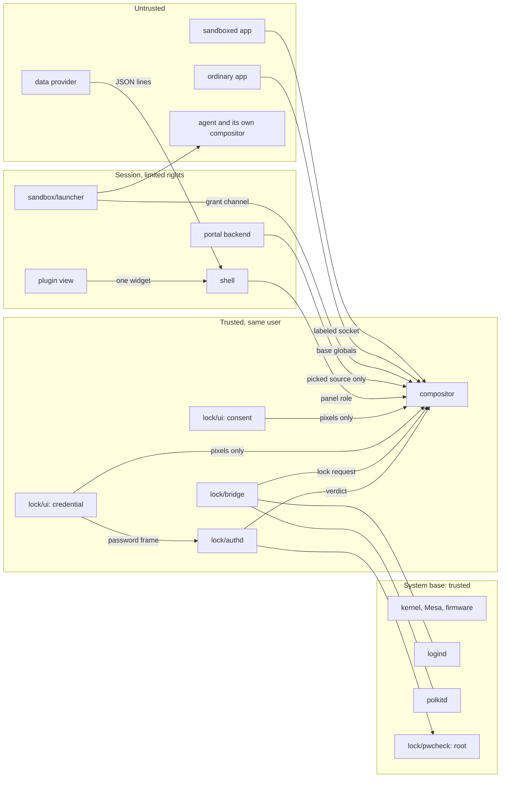

# Threat model

Skorupa protects one person's laptop session from applications and agents that act through the desktop's interfaces, and from a person who picks up the locked device. It gives **no** guarantee, not for the lock and not for the authenticity of prompts, against unrestricted code that already runs as the same user; against that attacker it only raises the cost. This document says which requirement holds against which attacker and what is out of scope.

- **Status:** pre-implementation draft, 2026-11-27. Requirement ids refer to [requirements.md](requirements.md). Almost no requirement has a passing proof yet, so every "yes" below means "required", not "shown".
- **Update rule:** a change to a trust boundary updates this file in the same change (REQ-OPS-017).

## Assets

| # | Asset | Why it matters |
| --- | --- | --- |
| S1 | The login password and anything else typed into a trusted prompt | It unlocks the session and authorizes polkit actions. |
| S2 | The lock state and the authority to unlock | It is the only barrier for a person holding the device. |
| S3 | Screen content: window pixels, window titles, notification text | Calls, messages, documents, credentials shown on screen. |
| S4 | Keystrokes and pointer input meant for one window | Passwords and private text typed into applications. |
| S5 | Clipboard content | Often holds passwords and tokens. |
| S6 | Microphone and camera streams | Live surveillance. |
| S7 | Consent decisions and grants | A forged or surviving grant gives away S3 to S6. |
| S8 | Input authority: the ability to act as the user in a window | Input into a terminal or a logged-in browser is full user authority. |
| S9 | The user's files, credentials on disk and network identity | Protected from agents by the sandbox, not by the compositor. |
| S10 | Availability of lock, unlock and the kill switch | A session that cannot be locked or stopped is unsafe. |

## Principals

All principals except `pwcheck`, logind, polkitd and the kernel run as the desktop user.

| Principal | Runs as | Holds | Trusted for | Must never |
| --- | --- | --- | --- | --- |
| `compositor` | user; DRM master and input devices from logind | window state, grants, lock state, lock epoch, the reserved strip, the retained clipboard copy | all four core properties; routing of every key event, including password keystrokes | store or log secrets (REQ-AUTH-009), parse client content, run commands |
| `lock/ui` credential instance | user; presentation-only role | the password while it is typed | drawing the lock and password prompts; passing the password to `authd` only | decide or request an unlock (REQ-LOCK-008) |
| `lock/ui` consent instance | user; presentation-only role; fresh process per prompt | untrusted strings: window titles, application names | drawing consent prompts and the source chooser | hold a password channel (REQ-TRUST-002) |
| `lock/authd` | user; no GUI, no network, no D-Bus | the unlock decision for the current epoch | issuing the one-use verdict (REQ-AUTH-001) | accept a decision from anyone but `pwcheck` |
| `lock/pwcheck` | root without capabilities; socket-activated; one request per process | the password for one PAM call | the PAM result, including the account check (REQ-AUTH-005) | keep state between requests |
| `lock/bridge` | user | D-Bus connections to logind and polkit | relaying `Lock` and sleep preparation; registering the polkit agent | unlock, or hold a password (REQ-AUTH-011, REQ-AUTH-012) |
| `shell` | user; layer-shell, window list, workspaces, input method | notification text, window titles, panel state | showing the panel, launcher and notifications; the on-screen keyboard | capture the screen, hold passwords, affect the lock (REQ-SHELL-001, REQ-SHELL-002) |
| plugin view process | user; separate restricted process | the data its provider sends | drawing one widget | see other widgets' data or notification text (REQ-PLUG-002, REQ-PLUG-003) |
| data provider | user; sandboxed, no session access | whatever it fetches | producing bounded JSON lines | reach session sockets (REQ-PLUG-004) |
| portal backend | user; capture right only for a picked source | the PipeWire stream of that source | delivering the picked source to the requester | choose a source, draw consent, capture anything else (REQ-CAP-002) |
| `sandbox/launcher` | user, then namespaces | agent profiles, the egress gate, cgroups | setting up the sandbox or failing closed (REQ-AGENT-003) | draw UI |
| ordinary application | user, unconfined | its own windows | nothing | — |
| sandboxed application | user, confined (security context, filtered buses) | its own windows | nothing | — |
| agent | user, confined in its sandbox with its own headless compositor | its own desk | nothing | reach the host session (REQ-AGENT-001) |
| logind, polkitd, PAM, kernel, Mesa, firmware | system | devices, authorization, drivers | everything; they are the base | — |

## Trust boundaries

| Boundary | Channel | Identity comes from | Held by |
| --- | --- | --- | --- |
| Client to compositor | ordinary socket, security-context listeners, inherited descriptors | how the connection was made, never UID, PID, app id or bus name | REQ-GRANT-002, REQ-GRANT-003, REQ-GRANT-004, REQ-GRANT-009, REQ-GRANT-012 |
| `lock/ui` to compositor | presentation-only role | inherited descriptor | REQ-LOCK-008, REQ-TRUST-001, REQ-TRUST-006 |
| Credential instance to `authd` | `protocol/` frames with epoch and attempt | inherited descriptor | REQ-AUTH-007, REQ-PROTO-002 |
| `authd` to compositor | one-use verdict | inherited descriptor | REQ-AUTH-001, REQ-AUTH-002, REQ-AUTH-004 |
| `authd` to `pwcheck` | socket activation across the root boundary | systemd | REQ-AUTH-005, REQ-AUTH-006 |
| Bridge to system bus | D-Bus | bus policy | REQ-AUTH-011, REQ-AUTH-012, REQ-LOCK-017 |
| Portal backend to compositor | capture of one picked source | inherited descriptor | REQ-CAP-001, REQ-CAP-002, REQ-CAP-003 |
| Shell to plugins | pipe (provider), restricted process (view) | the shell starts them | REQ-PLUG-002, REQ-PLUG-003, REQ-PLUG-004 |
| Host to agent sandbox | namespaces, egress gate, the agent's own compositor | the launcher | REQ-SBX-001 to REQ-SBX-006, REQ-AGENT-002 |
| Devices to compositor | logind hands over input and DRM | logind session | REQ-INPUT-001, REQ-OPS-001, REQ-OPS-002 |
| User to machine | reserved strip, reveal gesture, physical devices | device provenance | REQ-TRUST-003, REQ-TRUST-004, REQ-TRUST-005 |

## Ordinary client versus unrestricted same-user code

Two attackers are easy to confuse, and the difference decides every claim in this document.

| | Ordinary client using desktop interfaces (X3) | Unrestricted code running as the user (X9) |
| --- | --- | --- |
| What it does | Sends Wayland requests, calls session D-Bus services and portals, draws its own windows | Also reads and writes the user's files, configuration and service overrides, signals and inspects processes where the kernel allows, opens every socket and device the user can |
| Lock (properties A and B) | Guaranteed | **No guarantee** |
| Authenticity of password and consent prompts | Guaranteed | **No guarantee** |
| Secrecy of password, keystrokes, screen, clipboard | Guaranteed at the interface | **No guarantee** |
| What Skorupa offers | Default deny, grants, trusted UI | Hardening that raises the cost, and the sandbox as the place to run code that is not trusted |

The same program can be either: nothing confines an ordinary application, so it is X3 only for as long as it stays on the interfaces. A sentence that promises lock or prompt protection "against other code of the user" is true for X3 and false for X9. Where [design.md](design.md) says more than this table, this table is the intended statement and the design text is to be corrected.

## Attackers

| # | Attacker | Can do | In scope |
| --- | --- | --- | --- |
| X1 | Person with the locked device | keyboard, touch, lid, power button, USB ports, unlimited time; no disassembly | Yes; the primary adversary for the lock |
| X2 | Malicious input device | present itself as a USB keyboard or pointer, locked or unlocked | Partly: it gets no more than a person typing (see below) |
| X3 | Ordinary application using only desktop interfaces | Wayland requests, session D-Bus calls, portals, its own windows | Yes, at the interface level only |
| X4 | Sandboxed application | the same, through a labeled socket and filtered buses | Yes |
| X5 | Agent, including one steered by prompt injection | anything inside its sandbox and on its own desk; allowed network hosts | Yes |
| X6 | Plugin: data provider or view file | arbitrary output; arbitrary `.slint` content in the view process | Yes |
| X7 | Bug or logic flaw in a session component (shell, portal backend, bridge) | misuse the rights of that role | Yes, for the role's rights; full code execution there becomes X9 |
| X8 | Bug or logic flaw in `lock/ui` | draw wrong content, send any message its role allows | Yes, for unlock authority |
| X9 | Unconfined code running as the user | read and write the user's files, including configuration and user service overrides; talk to every session socket; signal processes; attach where the kernel allows | **No for integrity.** See below |
| X10 | Network | send traffic to the machine; serve content to applications and agents | Yes; no Skorupa component listens on the network |
| X11 | Root, kernel, firmware, hardware (DMA, cold boot, disassembly, evil maid) | everything | No |

## Attacker and property

`yes` means the requirements in the next table must hold against this attacker. `part` means they hold with a stated limit. `no` means out of scope. `n/a` means the attacker has no path to the property.

| Attacker | A: unlock needs auth | B: no unlocked frame after lock | C: revocation is final | D: agent needs a grant | Password secrecy | Keystroke secrecy | Screen secrecy | Prompt authenticity | Clipboard secrecy |
| --- | --- | --- | --- | --- | --- | --- | --- | --- | --- |
| X1 person, device locked | yes | part | n/a | n/a | part | n/a | part | n/a | yes |
| X2 malicious input device | yes | yes | n/a | n/a | yes | n/a | n/a | part | n/a |
| X3 ordinary app, interfaces only | yes | yes | yes | n/a | yes | yes | yes | yes | part |
| X4 sandboxed app | yes | yes | yes | n/a | yes | yes | yes | yes | part |
| X5 agent | yes | yes | yes | yes | yes | yes | yes | yes | yes |
| X6 plugin | yes | yes | n/a | n/a | yes | yes | yes | yes | yes |
| X7 flaw in shell, portal or bridge | yes | yes | yes | yes | yes | part | part | yes | part |
| X8 flaw in `lock/ui` | yes | yes | n/a | n/a | part | n/a | n/a | part | n/a |
| X9 unconfined same-user code | no | no | no | no | no | no | no | no | no |
| X10 network | yes | yes | n/a | n/a | yes | yes | yes | n/a | yes |
| X11 root, kernel, hardware | no | no | no | no | no | no | no | no | no |

### What holds, and the limits

| Attacker | Requirements that hold the line | Limits and what is out of scope |
| --- | --- | --- |
| **X1** person, device locked | REQ-AUTH-001, REQ-AUTH-003, REQ-AUTH-005, REQ-LOCK-001, REQ-LOCK-002, REQ-LOCK-010 to REQ-LOCK-017 (the failure table), REQ-LOCK-019, REQ-LOCK-020, REQ-LOCK-022 to REQ-LOCK-025, REQ-AUTH-015 to REQ-AUTH-018 | **Sleep limit:** after a sleep that Skorupa did not control (logind's delay ran out, the inhibitor was lost, or a valid unlock arrived between inhibitor release and suspend), the last frame shown before sleep, which can be a session frame, is visible from wake until the first lock frame is presented; no input reaches the session (REQ-LOCK-012, REQ-LOCK-018, open decisions O-4, O-29, O-30). Password guessing is limited only by PAM until open decision O-8 is settled. Watching the user type is out of scope. Anything needing disassembly or a boot from other media is X11; disk encryption is assumed and is outside Skorupa. |
| **X2** malicious input device | REQ-AUTH-001 (it must still know the password), REQ-TRUST-005, REQ-OPS-002 | A real USB device that types is indistinguishable from a keyboard the user attached. While unlocked it can type like the user; that is out of scope. Whether the provenance rule can exclude it from confirming prompts is open decision O-2. |
| **X3** ordinary app, interfaces only | REQ-GRANT-002, REQ-GRANT-004, REQ-GRANT-010, REQ-GRANT-011, REQ-GRANT-012, REQ-INPUT-002, REQ-INPUT-003, REQ-INPUT-004, REQ-AGENT-004, REQ-CAP-001 to REQ-CAP-005, REQ-TRUST-001, REQ-TRUST-003, REQ-TRUST-006, REQ-TRUST-007, REQ-TRUST-011, REQ-LAYOUT-006, REQ-API-004, REQ-LOCK-008 | "Interfaces only" is the limit (see the section above). The same program can act as X9 whenever it chooses, because it is not confined. Against X3 the design moves the attack from "call an API" to "tamper with a process or a file". Clipboard: the focused client receives the selection, as on every Wayland desktop. Microphone and camera: an unconfined application reaches PipeWire directly; Skorupa shows activity and does not claim control (REQ-PERM-003, REQ-PERM-006). |
| **X4** sandboxed app | the X3 list, plus REQ-GRANT-009, REQ-GRANT-014, REQ-PERM-004, REQ-PERM-010, REQ-PERM-011, REQ-PERM-012, REQ-SBX-006 | Holds only when the sandbox also removes the other paths (session bus, PipeWire, raw devices). Flatpak applications may land in the ordinary domain until open decision O-11 is settled; that loses the label, not the base policy. Stopping a live camera stream on Forget is unverified on the installed PipeWire stack. |
| **X5** agent | REQ-AGENT-001 to REQ-AGENT-006, REQ-AGENT-008 to REQ-AGENT-010, REQ-SBX-001 to REQ-SBX-006, REQ-GRANT-001, REQ-GRANT-005, REQ-GRANT-006, REQ-GRANT-013, REQ-GRANT-015, REQ-TRUST-005, REQ-OPS-002 | Whatever the user copies to the agent or types into the agent's desk is disclosed by the user's own act. Screen content inside the agent's own desk can steer the model; the egress gate and the absence of host grants are what bound the damage (REQ-AGENT-009). A kernel or bubblewrap escape is X11. After v1, a one-shot window capture deliberately discloses that window (REQ-CAP-011). |
| **X6** plugin | REQ-PLUG-002 to REQ-PLUG-006, REQ-SBX-007, REQ-DEP-007 | A view can draw misleading content inside its own widget area. It cannot draw in the reserved strip or over a trusted prompt. Plugins are registered in the user's `config.toml`, so installing one is the user's act. |
| **X7** flaw in shell, portal backend or bridge | Shell: REQ-SHELL-001, REQ-SHELL-002, REQ-LOCK-005, REQ-TRUST-006. Portal: REQ-CAP-002, REQ-CAP-003, REQ-GRANT-006, REQ-GRANT-008, REQ-GRANT-013. Bridge: REQ-AUTH-011, REQ-AUTH-012, REQ-LOCK-017, REQ-LOCK-024 | The shell legitimately sees window titles and notification text, and its input-method role sees text typed through the on-screen keyboard outside trusted mode. The portal backend sees the picked source while a share is live. The bridge can request a lock at will (nuisance); while it holds the sleep inhibitor, its failure lets the machine sleep before the lock is shown (REQ-LOCK-012, open decision O-30), and with the sleep-hold rule it could also deny unlock (O-29). These hold for misuse of the role. If the flaw gives code execution, the attacker is X9 unless the component's service unit confines it (open question T-1). |
| **X8** flaw in `lock/ui` | REQ-AUTH-001, REQ-AUTH-002, REQ-AUTH-018, REQ-LOCK-008, REQ-LOCK-014, REQ-TRUST-002, REQ-TRUST-010, REQ-TRUST-012 | The credential instance sees the password by design; a flaw there can leak it only through a channel the process has, so its confinement matters (T-1). The consent instance parses untrusted strings; who interprets the user's answer to a consent prompt is not yet specified (T-2), so a flaw there may be able to approve a request. It cannot unlock. |
| **X9** unconfined same-user code | Nothing is claimed. Hardening that raises the cost: REQ-OPS-001, REQ-OPS-002, REQ-OPS-003, REQ-OPS-005, REQ-GRANT-003, REQ-GRANT-011 | **Explicitly out of scope: no lock guarantee, no prompt-authenticity guarantee, no confidentiality guarantee.** Such code can edit the hot-reloaded configuration (which registers provider commands), override user services and environment for the next session, read the user's files, use the microphone and camera through PipeWire, imitate any window, and kill session processes. With the deployment prerequisites met it can no longer read raw key events or attach to unrelated processes, but it can change what runs next time. The defense is not to run untrusted code unconfined: use the sandbox. |
| **X10** network | REQ-AUTH-010, REQ-SBX-003, REQ-API-008 | Content delivered to a browser or an agent is that application's problem (X3 to X5). |
| **X11** root, kernel, hardware | Nothing | Out of scope. The C libraries and drivers in the base are recorded per hardware test (REQ-DEP-010). |

## Deployment prerequisites

The claims above assume these. They are generic: a deployment preflight checks them on the target machine and fails when one is missing. Readings from any particular machine are not recorded in this repository.

| Prerequisite | Why | Requirement |
| --- | --- | --- |
| The user account is not in the `input` group | Members can read every key event from the kernel's input devices, including the lock password, which bypasses every trusted-UI measure. logind hands the devices to the compositor, so the membership is not needed | REQ-OPS-001, REQ-INPUT-001 |
| No agent or sandboxed process can open `/dev/uinput` | A virtual keyboard below the compositor defeats "physical" input | REQ-OPS-002, REQ-SBX-002 |
| Yama `ptrace_scope` is at least 1 | Otherwise any process of the user can read the memory of the shell, the portal backend and `authd` | REQ-OPS-003 |
| The greeter authenticates; no automatic login | A compositor restart must not yield an unlocked session | REQ-OPS-004, REQ-LOCK-013 |
| Trusted processes are not dumpable; privileged binaries live in root-owned paths | Cheap protection against same-user tampering | REQ-OPS-005 (proposed) |
| The portal backend runs with the compositor's chooser, restore disabled and quiet logs | Otherwise a share can skip the chooser and window titles reach the journal | REQ-CAP-001, REQ-CAP-005, REQ-CAP-008 |
| No installed helper can capture the screen outside the compositor, or its disposition is recorded | A recorder with direct KMS access bypasses the compositor's exclusions and indicators | REQ-OPS-019 (proposed) |
| The account is in no group that is equivalent to root | Such a group turns X9 into X11 | none; deployment note |
| logind's sleep delay is read at run time, not assumed | The delay bounds how long Skorupa controls the start of sleep | REQ-LOCK-012, REQ-LOCK-018 |
| A fallback session under another compositor is understood to be outside this model | niri, for example, gives ordinary clients capture, synthetic input, clipboard observation and layer-shell by design | REQ-OPS-015 |

## Known gaps

Found in research and review. "Checked" means re-read in source for this document; "reported" means taken from the research or a review without re-checking.

| # | Gap | Evidence | Consequence | Handled by | What remains |
| --- | --- | --- | --- | --- | --- |
| G1 | **Key-observation interfaces on D-Bus.** A May 2026 disclosure showed raw key capture in Mutter and KWin through a keyboard-monitor interface guarded only by a claimable bus name. The reference niri revision serves `org.freedesktop.a11y.KeyboardMonitor`, whose watch and grab methods take any session-bus sender. | Mutter and KWin: reported (the research marks a runtime reproduction on current Mutter as unverified). niri: checked in source, `src/dbus/freedesktop_a11y.rs:109-170`, and measured by the API probe on a nested instance (see [api-map.md](api-map.md)) | A short Wayland protocol list is worthless if the same power is on the session bus | REQ-API-004, REQ-INPUT-002, REQ-SBX-001 | A screen reader needs some such path; see G2 |
| G2 | **Accessibility bus (AT-SPI).** Applications publish their text and accept actions over it. Nobody has decided whether it runs under Skorupa or who may reach it. | Reported (discussion outcome) | A reachable accessibility bus exposes window text and synthetic actions to any session-bus client | REQ-API-009, REQ-SBX-001 | Open decision O-13. Until it is settled, S3 and S8 are not protected against X3 on that path |
| G3 | **Portal restore skips the chooser.** xdg-desktop-portal-wlr tries stored restore data before it calls the chooser. | Checked: v0.9.0 `src/screencast/screencast.c:163-166` | "Fresh pick for every share" is false with the stock backend | REQ-CAP-001, REQ-CAP-002 | Needs the patch or configuration and a test with a pre-existing token after lock and restart |
| G4 | **Portal logs window titles.** The same function logs every capturable window's id, app id and title at INFO before the chooser runs, even if the user cancels. | Checked: v0.9.0 `src/screencast/screencast.c:151-152` | Titles of unrelated windows land in the journal | REQ-CAP-008, REQ-OPS-016 | Patch or log-level setting; canary test |
| G5 | **The chooser does not know who asks.** The backend receives the requester's app id on D-Bus but its chooser code never uses it. | Checked: v0.9.0 `src/screencast/chooser.c` has no `app_id` reference | Consent would read "an application wants to share" | REQ-CAP-003, REQ-TRUST-011 | The requester-binding patch; how the compositor learns the requester is not designed yet |
| G6 | **Portal Screenshot writes a fixed path.** It runs `grim` and returns `/tmp/out.png`. | Checked: v0.9.0 `src/screenshot/screenshot.c:20-25,120-121` | A world-readable, predictable file; a symlink target | REQ-CAP-007 | Own adapter. Whether `grim` could run at all without legacy screencopy was disputed between reviewers and no longer matters |
| G7 | **Clipboard does not survive the source application.** With `data-control` given to nobody, no clipboard manager can keep the selection. | Reported (protocol behavior) | Copied text vanishes when the application closes | REQ-API-006, REQ-LOCK-020 | Limits of the retained copy: open decision O-22. The copy is itself a new place where S5 lives, hence the clear at lock |
| G8 | **Notifications during capture and lock.** A popup would appear in a shared screen, and message text on the lock screen. | Reported | S3 leaks into a call or to X1 | REQ-CAP-004, REQ-SHELL-004, REQ-LOCK-022 | Per-window exclusion rules like niri's `block-out-from`: open decision O-18 |
| G9 | **The `input` group.** Membership gives every process of the account the raw key events. | Linux device permissions: reported in the discussion outcome | The lock password and every keystroke are readable below the compositor | REQ-OPS-001 | A deployment prerequisite; Skorupa can only check it |
| G10 | **`uinput` and the meaning of "physical".** | Linux behavior: reported | A process with `uinput` can press the reveal gesture, the kill switch or "Allow" | REQ-TRUST-005, REQ-OPS-002, REQ-SBX-002 | The provenance rule: open decision O-2 |
| G11 | **The standard lock protocol lets the lock client unlock.** Smithay marks the session unlocked before it calls the compositor; today's lock client sends the request. | Checked: Smithay `46643d20` `src/wayland/session_lock/lock.rs:117-124`; Rygiel `crates/rygiel/src/app.rs:899-901` | A flaw in the lock UI unlocks the session | REQ-AUTH-001, REQ-LOCK-008, REQ-LOCK-009 | The bring-up milestone with the unchanged lock still has this gap and must not be used daily |
| G12 | **niri unlocks when the locked frame fails to render.** | Checked: niri `src/niri.rs:5143-5146` | A render failure at the wrong moment cancels the lock | REQ-LOCK-011 | Code ported from niri's redraw path must not carry this branch over |
| G13 | **Flatpak falls back to the ordinary socket** when it cannot create a security context. | Reported (one review, against Flatpak source) | Flatpak applications get the ordinary domain, not the sandboxed one | REQ-GRANT-009 | Open decision O-11 |
| G14 | **Virtual input protocols address a seat, not a window.** | Reported (protocol definitions) | A "type into this window only" grant cannot be built on them | REQ-AGENT-004, REQ-AGENT-010 | Host input for agents is not planned |
| G15 | **Ambient microphone and camera for unconfined applications.** PipeWire, its PulseAudio endpoint and raw devices are reachable by X3. | Reported (research file 11) | A per-app microphone prompt would be theater | REQ-PERM-003, REQ-PERM-006 | Indicator only in v1 |
| G16 | **The compositor sees password keystrokes.** | By construction | "The compositor never sees passwords" was false | REQ-AUTH-009, REQ-INPUT-001 | The compositor is in the trusted base for S1 |
| G17 | **The GPU constructors are `unsafe`.** Smithay's EGL and GLES constructors are `unsafe`; its `GbmGlesBackend` calls them inside Smithay, so Skorupa's own code needs none. The headless path has no safe GLES constructor. | Constructors checked: `src/backend/egl/display.rs:243`, `src/backend/renderer/gles/mod.rs:575`; Pixman's constructor is safe, `src/backend/renderer/pixman/mod.rs:714`. Bring-up through `GbmGlesBackend`: reported (VM spike); the laptops are unverified | The `unsafe` is in the dependency, not gone | REQ-DEP-002, REQ-DEP-008, REQ-AGENT-002 | Raw GL in own code needs a new owner decision. Pixman is a C library in the agent's compositor |
| G18 | **Skorupa does not control the start of sleep.** logind bounds the inhibitor delay, and the inhibitor ends with the process that holds it. | systemd semantics: reported; Quint model finding 2 | The machine can sleep before the lock frame is shown. On wake the frame shown before sleep is visible until the first lock frame | REQ-LOCK-012, REQ-LOCK-015, REQ-LOCK-016, REQ-LOCK-025 | Deadline fallback and inhibitor ownership: open decisions O-4 and O-30 |
| G19 | **Stream identifiers can be reused.** | Reported (portal documentation, via one review) | Stop could hit the wrong stream | REQ-GRANT-008 | |
| G20 | **Hidden clients can hold an idle inhibitor.** | Reported (one review) | Auto-lock never fires | REQ-LOCK-006 (proposed) | Open decision O-23 |
| G21 | **A valid unlock can undo a sleep lock.** After the lock is acknowledged and the inhibitor released, a verdict for the current epoch and attempt still unlocks; the machine then suspends showing the session. | Quint model finding 1 (simulation and a hand-written trace; not exhaustive) | X1 sees the last session frame on wake until the lock frame is presented | REQ-LOCK-018, REQ-LOCK-015 | The sleep-hold rule: open decision O-29. Its cost is that a silent bridge can deny unlock |
| G22 | **Old verdicts after a restart, a resume or a broker disconnect.** Counters restart with the compositor; a verdict can cross a sleep or a broker restart. | Quint model findings 3 and 4; cross-review of the model | An unlock for an attempt nobody is making now | REQ-AUTH-015, REQ-AUTH-016, REQ-AUTH-017, REQ-AUTH-018, REQ-LOCK-025 | The model merges instance and session into one field; Rust must test each |
| G23 | **Revocation in the reducer does not stop an effect already emitted.** | Quint model finding 7 | A frame or transfer is delivered after lock, reconnect or expiry | REQ-GRANT-013, REQ-GRANT-014, REQ-GRANT-008 | |
| G24 | **Camera consent is an ordinary toolkit window, and a decision was stored for an empty requester.** | Measured by the API probe with the stock backends (see [api-map.md](api-map.md)) | The prompt can be imitated or covered, names nobody, and one answer applies to every unsandboxed program | REQ-PERM-011, REQ-PERM-012 | The `Access` backend has no owner or budget yet: open decision O-31 |
| G25 | **A capture helper outside the compositor.** A recorder with direct KMS access sees everything on the panel. | Reported (cross-review) | Exclusions, indicators and Stop do not apply to it | REQ-OPS-019 (proposed), REQ-CAP-010 | Open decision O-18 |
| G26 | **A region drawn in a chooser does not limit the delivered pixels.** | Reported (cross-review, against the tagged portal backend) | A "region" share delivers the whole monitor or window | REQ-CAP-012 | Open decision O-18 |

## Open questions for this model

These add to the open decisions in [requirements.md](requirements.md#open-decisions).

| # | Question | Why it matters |
| --- | --- | --- |
| T-1 | Are the shell, the portal backend, the bridge and `lock/ui` confined by their service units (no network, read-only home, no new privileges)? | Without confinement, code execution in any of them is X9, and the role separation only contains logic flaws. The design specifies this for `authd` and `pwcheck` only. |
| T-2 | Who interprets the user's answer to a consent prompt: the consent instance, or the compositor from the physical event and a button region the instance declared? | If the instance reports the answer, a flaw in the process that parses untrusted titles can approve a grant. Unlock has a broker for this; consent has none yet. |
| T-3 | Is disk encryption a stated prerequisite? | X1 with a boot stick is otherwise trivially X11. It is assumed here and written nowhere. |
| T-4 | Can any provenance rule tell a malicious USB keyboard from the user's own? | If not, X2 can confirm prompts while the session is unlocked, and the limit must be stated to the user. |
